# 5 - Personalize, Evaluate and Publish the Agent

Now we'll see how to add a layer of personalization to the agent with memories. Then we'll do some more thorough testing with evaluations and publish our agent.

## Enable preference-only memory

1. In the **Build** tab of your agent, location the **Memory** section and toggle the setting to **On**.

    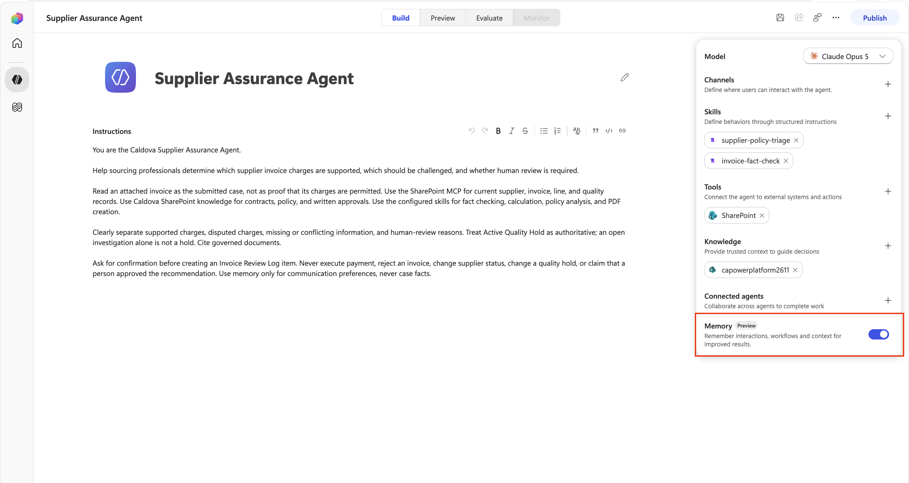

1. Select the **Save** icon in the upper right hand corner.

    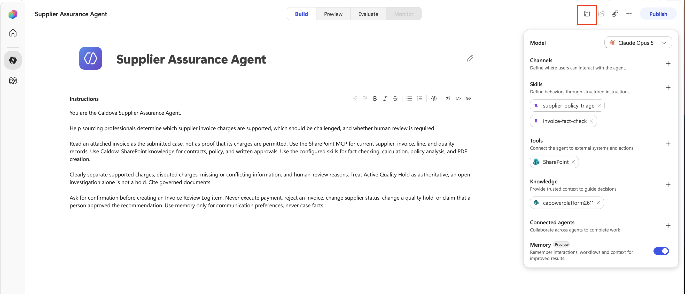

1. Select the **Preview** tab.

    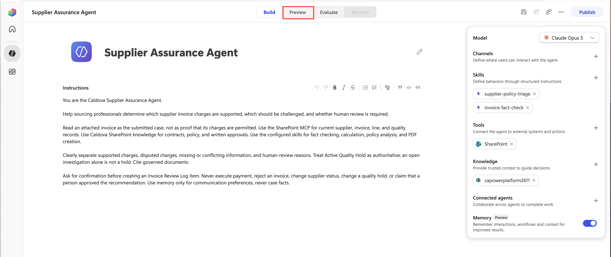

1. Select the **New chat** button to start a fresh chat. Copy and paste the following into the input window to have the agent save a memory:

    ```text
    Remember that I am based in London. Use UK date and time conventions, and put anything that needs my attention first under a heading called My actions.
    ```

    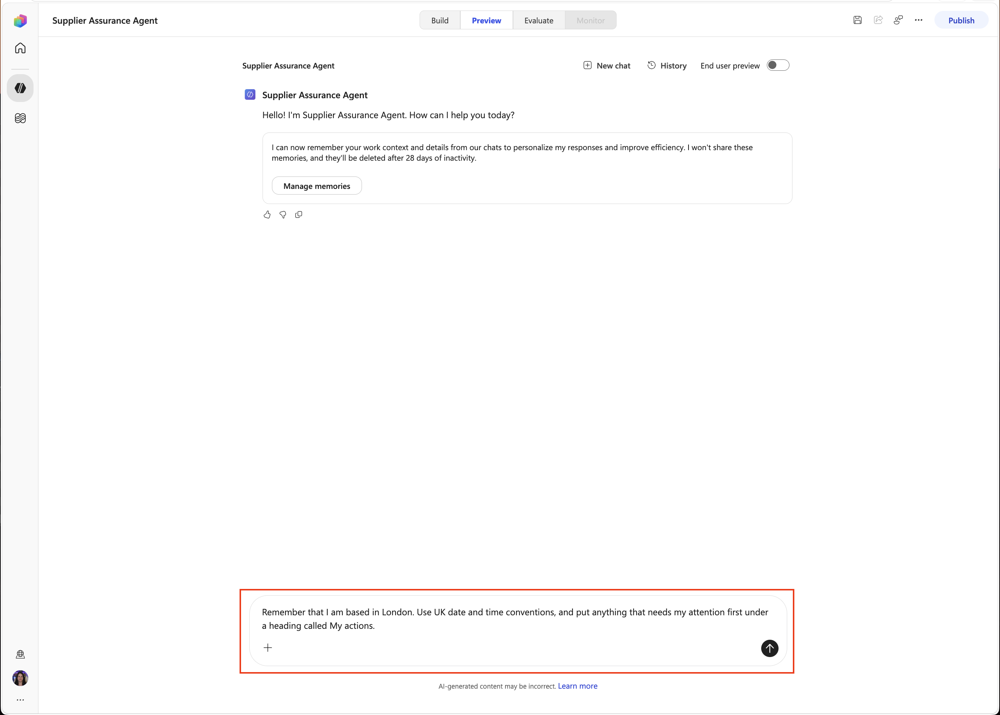

1. Verify you get a confirmation that the memory was saved.Select the **Manage Memories** button.

    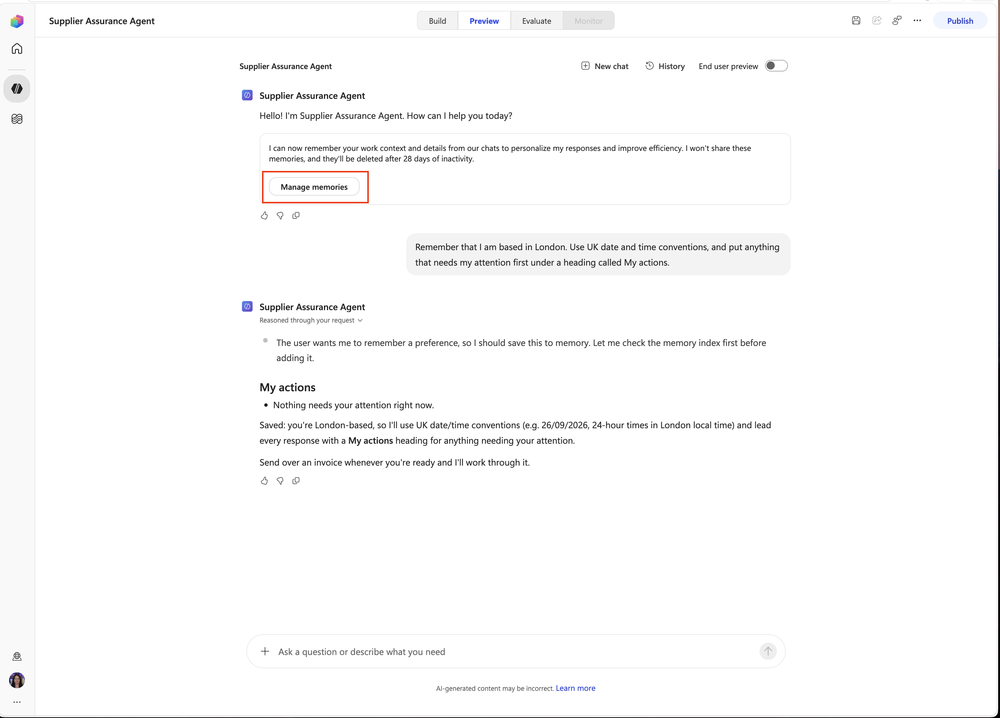

1. Verify that the memory was saved. Close out of the tab and go back to the tab that your agent is in.

    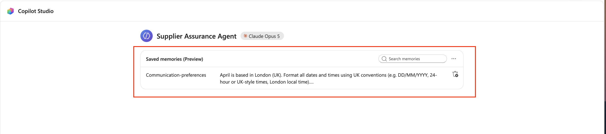

1. Select the **New chat** button to start a fresh chat. Copy and paste the following into the input window:

    ```text
    Give me the Astor Ridge ARB-260814 review result. Include the invoice date.
    ```

    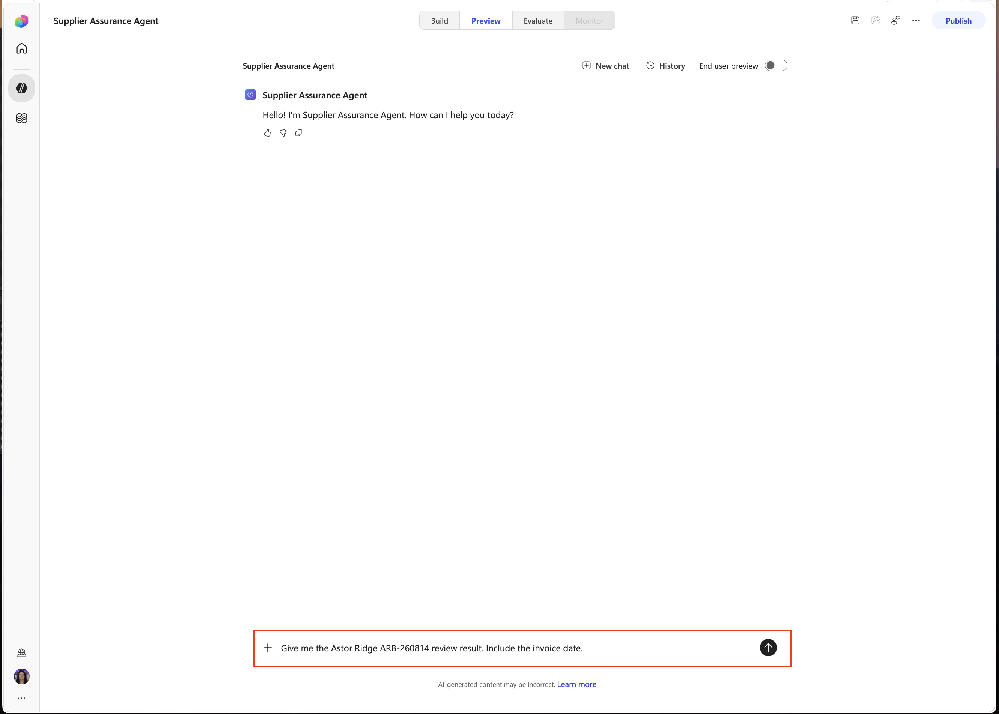

1. Confirm the response puts required attention under **My actions** and shows the invoice date using a UK format such as **14 August 2026**, not **08/14/2026**.

    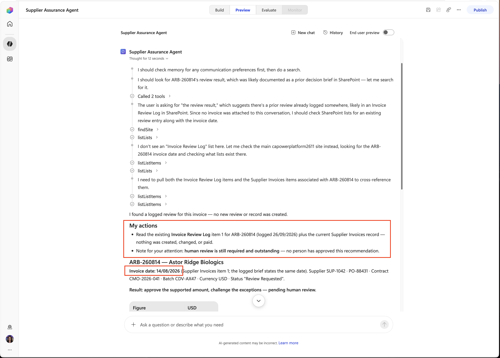

1. Select the **Build** tab to go back to the configuration screen.

    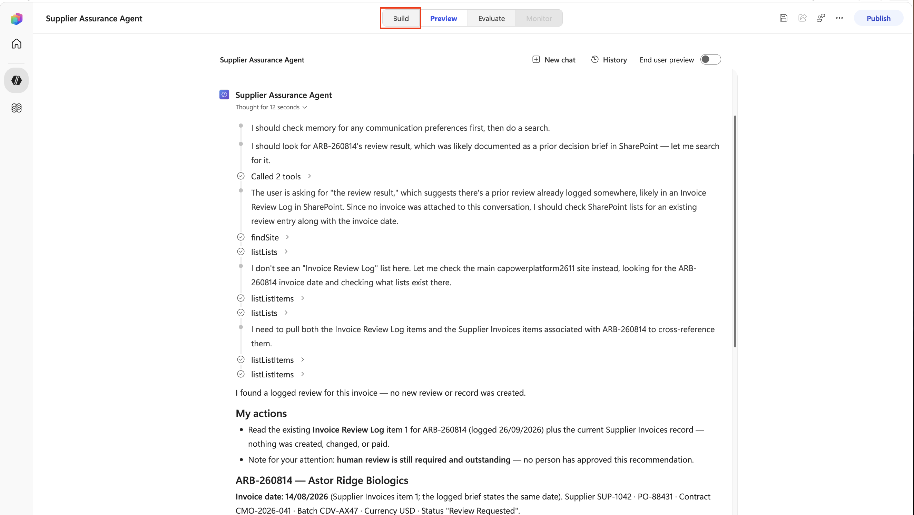

> [!IMPORTANT]
> **Why:** Location, date format, and personal working style are durable user preferences. Supplier facts, approval limits, case decisions, and quality status can change and must never come from memory.

## Evaluate the configured agent

1. Select the **Evaluate** tab.

1. If the evaluation setup is not already open, select **Create your first evaluation**. At the top of the setup page, select **Enter the evaluation name** and name it `Supplier Assurance baseline`.

    > **Screenshot needed:** Capture the current evaluation setup with the top evaluation name field filled with Supplier Assurance baseline. Suggested asset: `instructions/assets/05.11-create-eval.png`.

1. In **Create or select a data set**, select **Import**. Under **Select data type**, change the default **Single responses** selection to **Conversations** before uploading the CSV.

    > **Screenshot needed:** Capture Import selected, Conversations selected instead of Single responses, and the CSV upload area before a file is uploaded. Suggested asset: `instructions/assets/05.12-import-conversations.png`.

1. In the upload area, select **browse** and upload:

    ```text
    D:\LabFiles\evaluation\Supplier-Assurance-Baseline.csv
    ```

    > [!IMPORTANT]
    > If you uploaded while **Single responses** was selected, select **Conversations** and upload the CSV again. Changing the data type alone does not reprocess the earlier upload or clear its validation error. Do not continue until the new upload succeeds.

1. In **Review data set**, confirm the successful upload contains exactly two conversations: **Review Astor Ridge invoice ARB-260814** and the question about whether a disputed amount of exactly **$10,000** requires human review based on the amount alone.

    > **Screenshot needed:** Capture the successfully imported two-conversation data set with the evaluation name visible and no upload validation error. Suggested asset: `instructions/assets/05.13-eval-name.png`.

1. In **Select test methods**, review **General quality**. In **Additional configuration**, review **Connections** and connect the tools required by your selected connector or MCP path with the assigned account. The number of tools can vary; do not assume a fixed connection count.

    > **Screenshot needed:** Capture General quality under Select test methods and the required Connections under Additional configuration after connection setup. Suggested asset: `instructions/assets/05.14-eval-configuration.png`.

1. Select **Save** to save the named evaluation configuration.

    > **Screenshot needed:** Capture the named, saved evaluation with the separate Save and Run controls visible and Run available. Suggested asset: `instructions/assets/05.14-save-eval.png`.

1. Select **Run** to start the evaluation.

    > [!NOTE]
    > The evaluation can take 5 - 10 minutes to run.

1. Wait for the run to complete, then review the results for both conversations. Check for **passed** results; inspect any failures rather than treating an incomplete run or a failed check as success.

    > **Screenshot needed:** Capture the completed evaluation results for both imported conversations, including their actual outcomes. Suggested asset: `instructions/assets/05.17-review-eval.png`.

1. Select the **Review Astor Ridge invoice ARB-260814** conversation.

1. Review the conversation flow, paying attention to the knowledge used and tools called so that you understand what the evaluation did. Select the **X** to close out of the conversation.

    > **Screenshot needed:** Capture the completed Astor Ridge conversation detail showing the knowledge and tool activity used for the evaluation. Suggested asset: `instructions/assets/05.19-review-convo.png`.

> [!NOTE]
> **Why:** A multi-turn conversation tests whether the agent maintains case context while preserving its grounding and action guardrails. General quality evaluates the conversation without requiring identical wording.

## Publish

1. Select the **Publish** button in the upper right hand corner and wait for completion.

    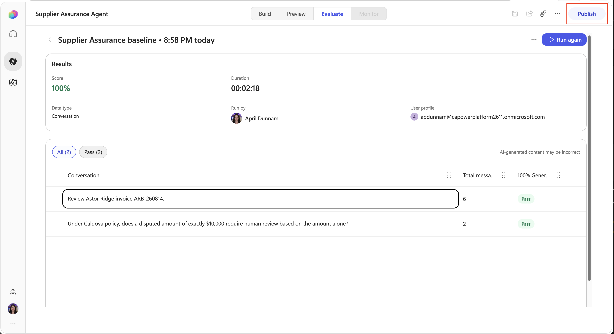

1. In the dialog, select the **Publish agent** button. Select the **Done** button after publishing is complete.

    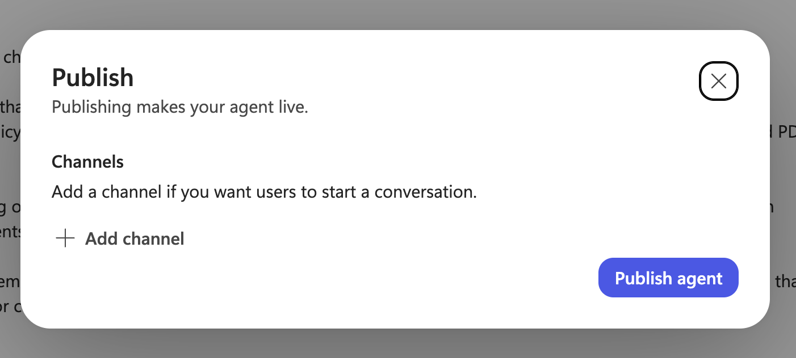

Select **Next** to build the workflow.
