# 6 - Build the Workflow

Now you'll create a Workflow that starts an invoice review when a SharePoint request is added. The Workflow only orchestrates the work; your agent retrieves records, applies policy, and produces the response.

This unattended path reviews an invoice by ID without an attached file. It stores the readable response on the request item; it does not explicitly persist a generated PDF or create an Invoice Review Log entry. Do not remove the agent's interactive confirmation requirement to make the workflow run.

## Create the Workflow

1. Select the **Workflows** tab in Copilot Studio.

    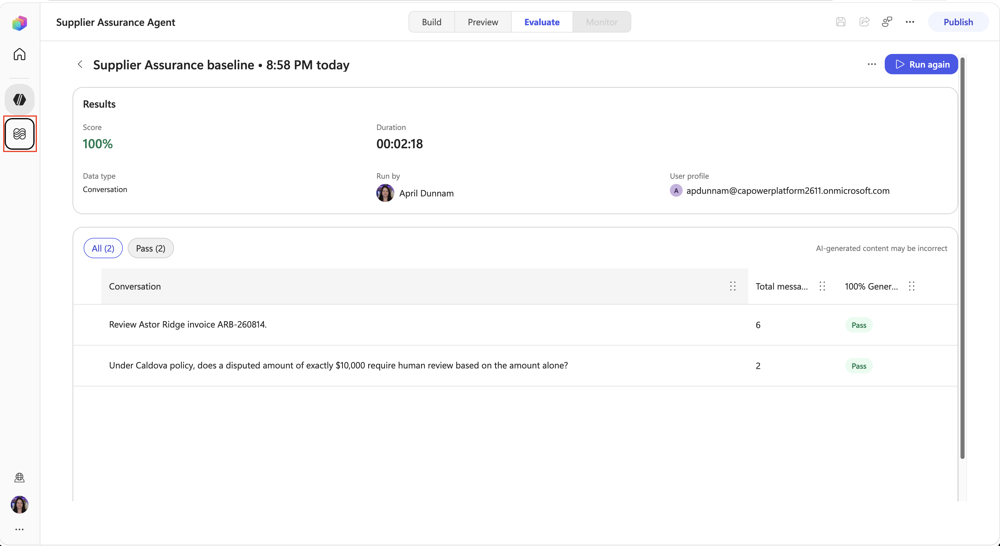

1. Select the **Create your first workflow** button.

    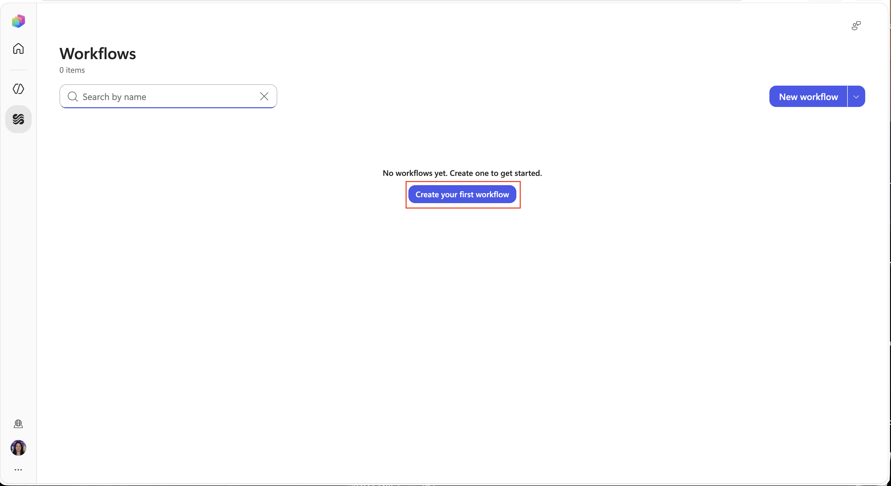

1. Select the **Untitled workflow** text in the upper-left corner. Replace the name with the following:

    ```text
    Process Supplier Invoice Review Request
    ```

    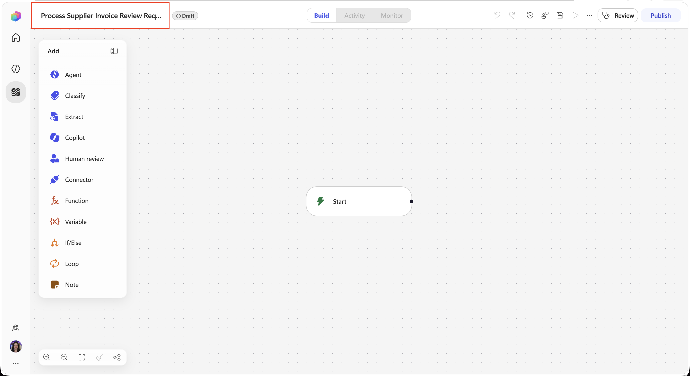

## Add the SharePoint trigger

1. Select the **start node**. Select the **Trigger type** dropdown and select the **Connector** option.

    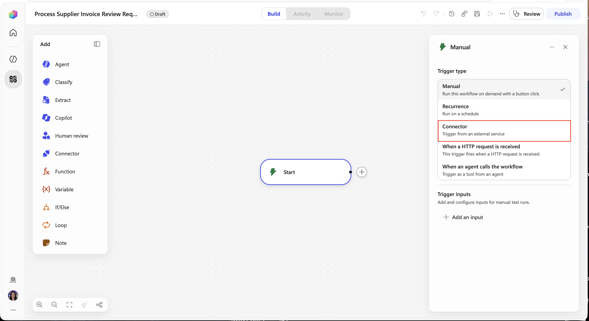

1. In the search box, type `SharePoint When an Item is Created` and select the **When an item is created** trigger.

    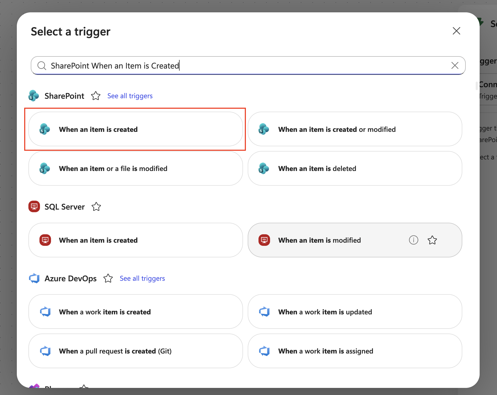

1. In the right-hand panel, configure the following:

    | Field | Value |
    | --- | --- |
    | Site Address | +++https://@lab.CloudCredential(AITour27M365E7).TenantPrefix.sharepoint.com/sites/CaldovaSupplierOps+++ |
    | List Name | `Invoice Review Requests` |

    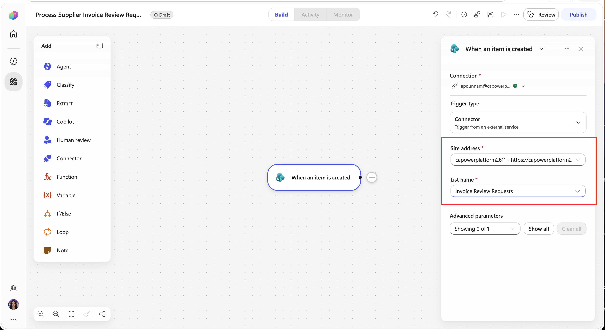

## Add the agent

1. Select the **plus button** next to the **when an item is created** node.

    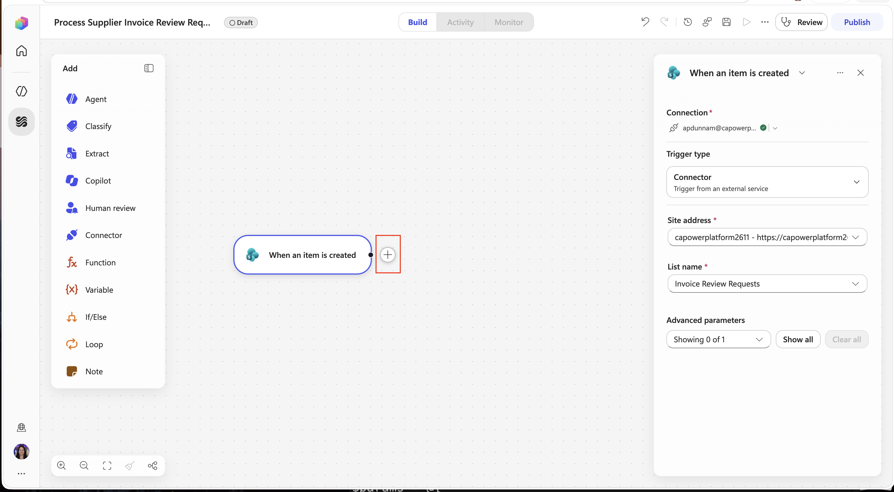

1. Select the **Agent** action from the list of options.

    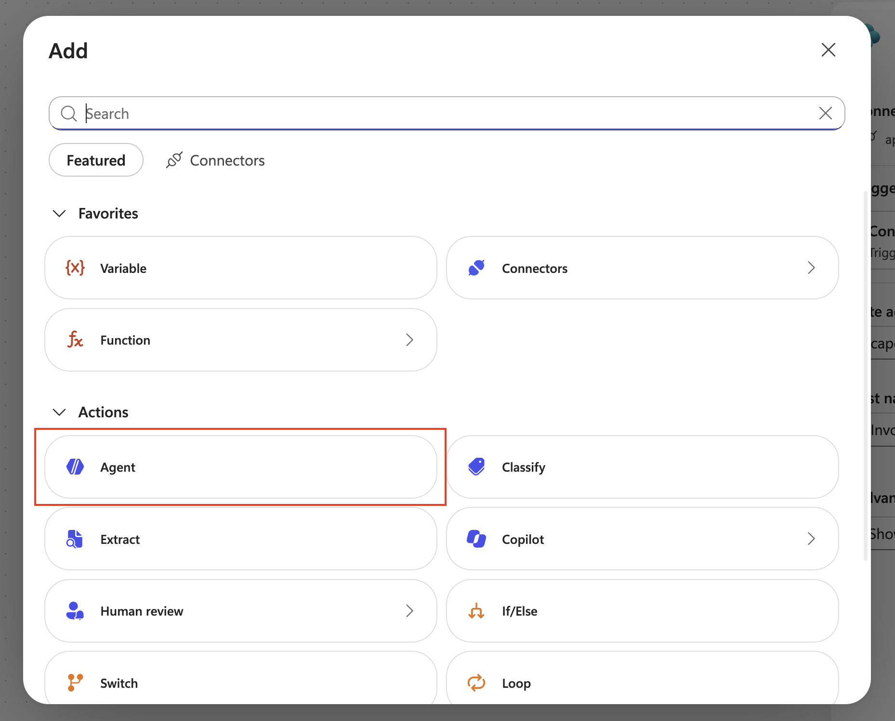

1. Select the **Supplier Assurance Agent** in the **Agent** dropdown on the right-hand side.

    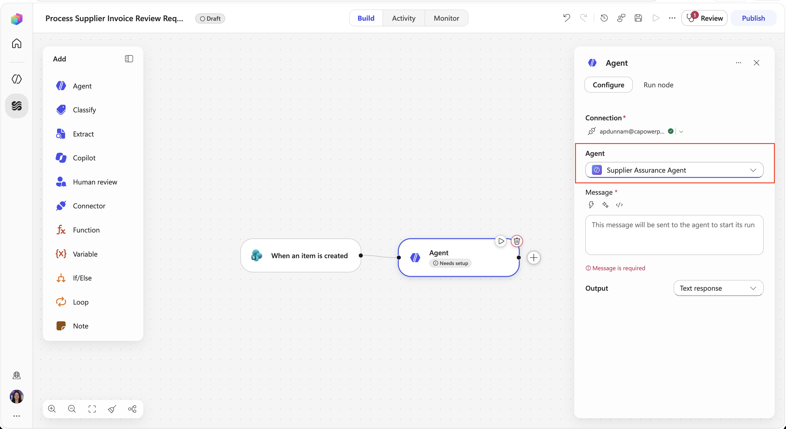

1. Copy and paste the following into the **Message** input.

    ```text
    Review supplier invoice [Invoice ID].

    Request notes: [Request Notes]

    No invoice file is attached. Use the configured SharePoint tools (connector actions or MCP) to retrieve the invoice and its lines by the supplied invoice ID, along with current supplier and quality records. State that no submitted file was compared. Use Caldova SharePoint knowledge for the governing contract, approvals, and policy. Run invoice-fact-check and supplier-policy-triage.

    Return supported and disputed amounts, reconciliation difference, human-review status and reasons, evidence citations, and a statement that no financial or supplier action was taken.

    This is an unattended review. Do not create an Invoice Review Log entry or request confirmation to create one in this run. The workflow will store your response on the request item. Do not take financial action or treat workflow completion as human approval.
    ```

    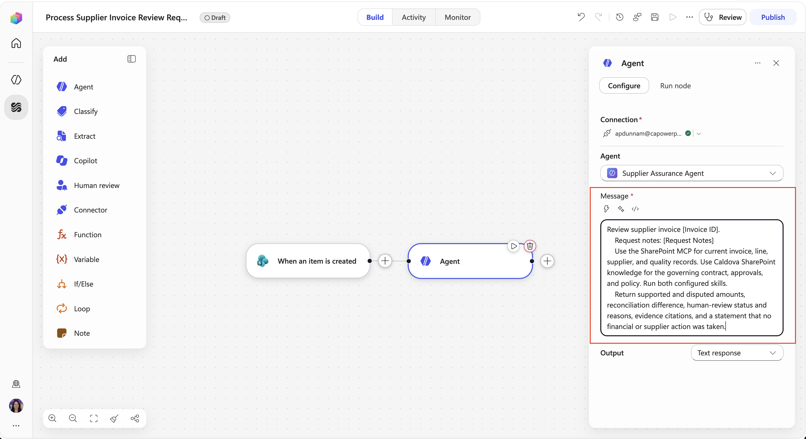

1. Delete the **[Invoice ID]** placeholder in the message. With your cursor where the text was, select the **lightning bolt icon**.

    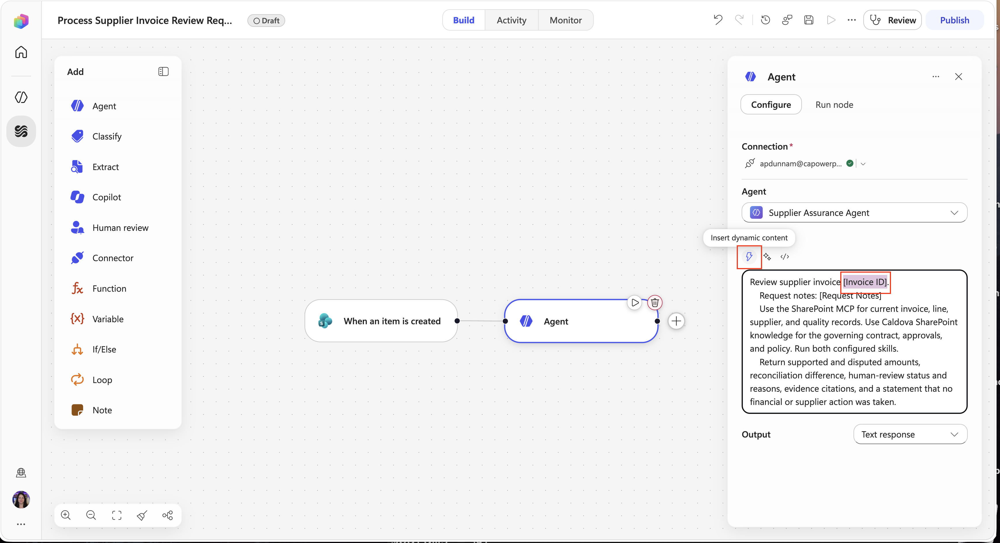

1. Select the **Invoice ID** property from the **When an item is created** trigger.

    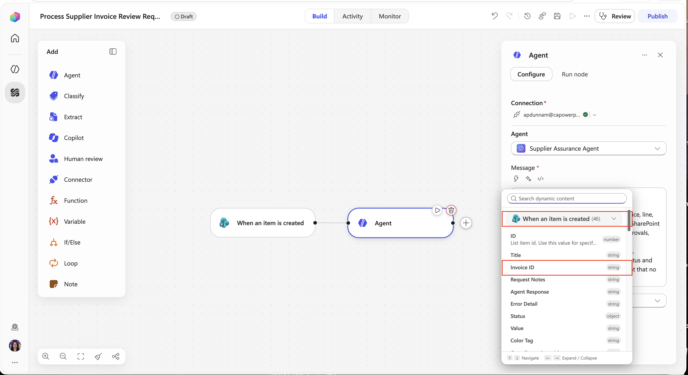

1. Delete the **[Request Notes]** placeholder in the message. With your cursor where the text was, select the **lightning bolt icon**.

    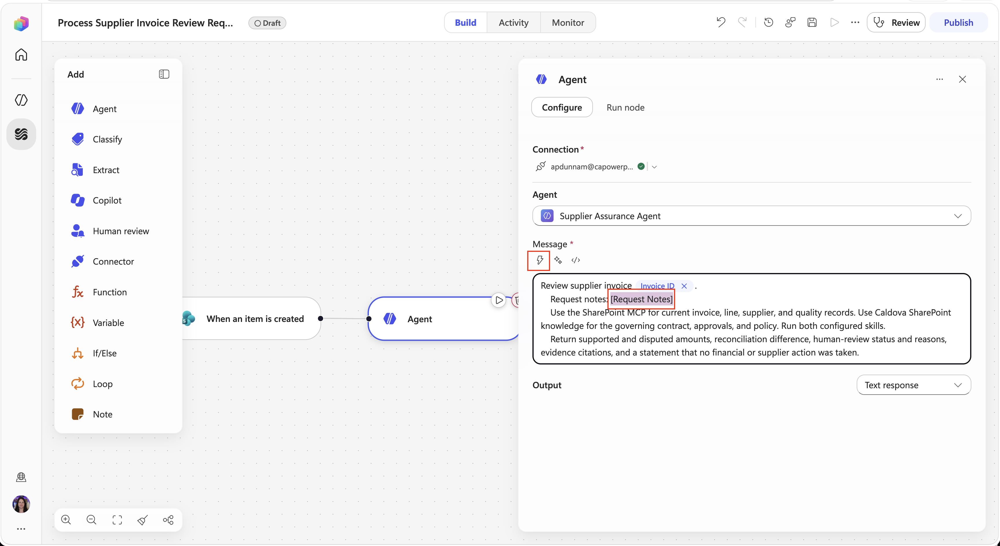

1. Select the **Request Notes** property from the **When an item is created** trigger.

    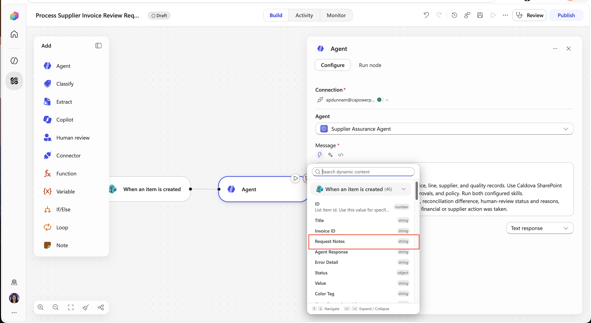

## Update the request

1. Select the **plus button** next to the **Agent** node.

    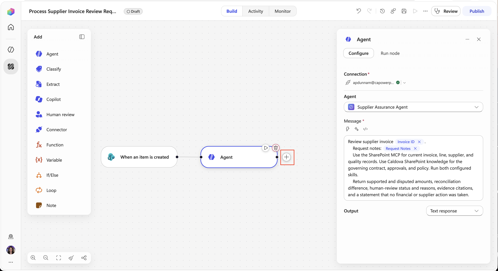

1. In the search box, type `SharePoint update item` and select the **Update item** action.

    

1. In the right-hand panel, configure the properties as follows. Select the **lightning bolt icon** to select dynamic values. For **Agent Response**, select **Result** from the **Agent** node, not from the SharePoint trigger:

    | Field | Value |
    | --- | --- |
    | Site Address | +++https://@lab.CloudCredential(AITour27M365E7).TenantPrefix.sharepoint.com/sites/CaldovaSupplierOps+++  |
    | List Name | `Invoice Review Requests` |
    | Id | Trigger `ID` |
    | Title | Trigger `Title` |
    | Invoice ID | Trigger `Invoice ID` |
    | Request Notes | Trigger `Request Notes` |
    | Status | `Complete` |
    | Agent Response | Agent node `Result` |
    | Error Detail | Leave blank |

    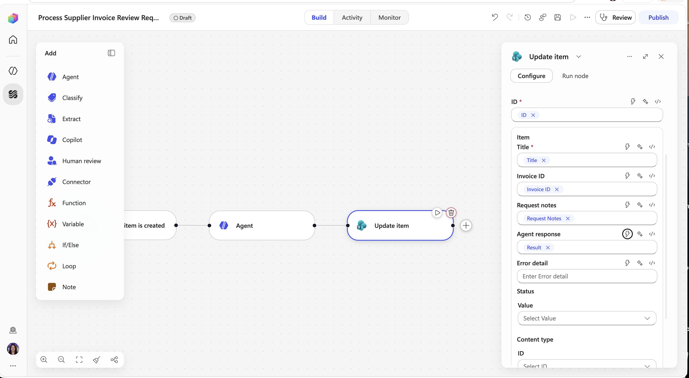

    > [!IMPORTANT]
    > **Complete** means the workflow reached its final update step, not that Finance approved the invoice or that all evidence was available. Review the stored response for missing evidence or other limitations. A failed node may leave the request at **New**; inspect **Activity** for the failure rather than assuming the blank **Error Detail** field means success.

1. Select the **Publish button** to save and publish your changes.

    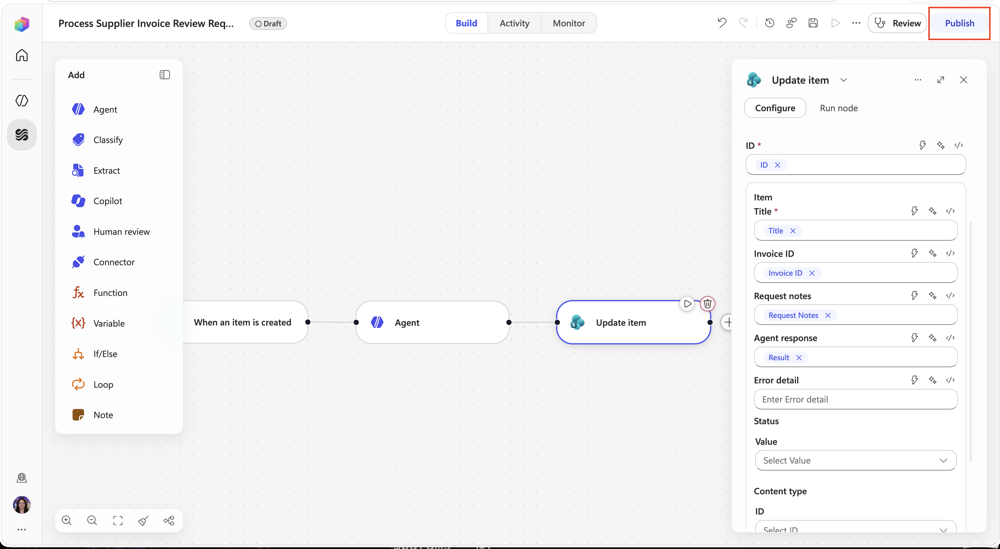

> [!NOTE]
> **Why:** The workflow provides a predictable trigger and stores the result. The agent owns SharePoint retrieval through its configured connector actions or MCP, knowledge grounding, skill execution, and policy reasoning. The workflow automates processing, not financial approval.

Select **Next** to run the final test.
