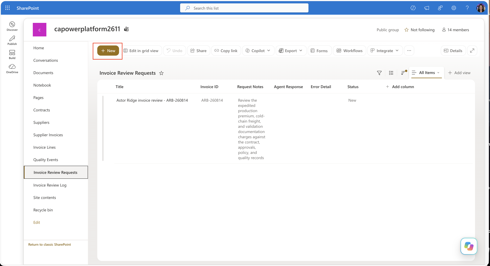
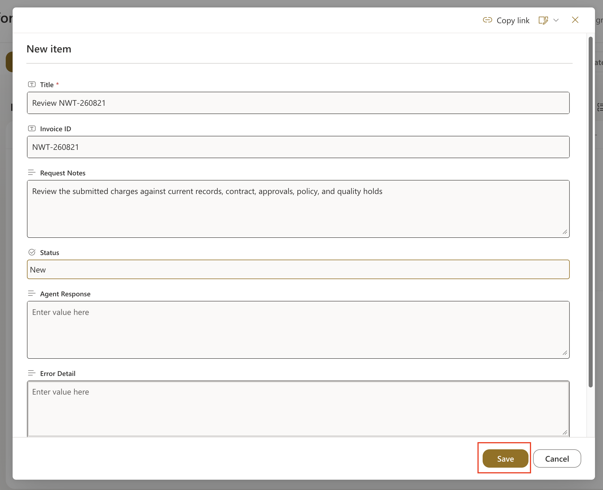
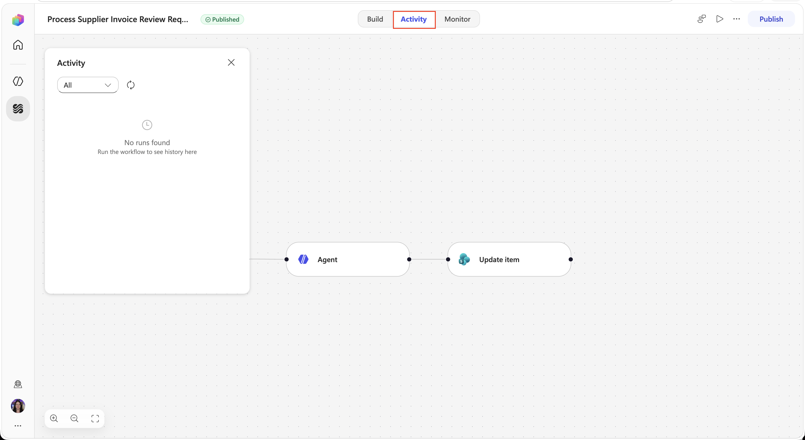
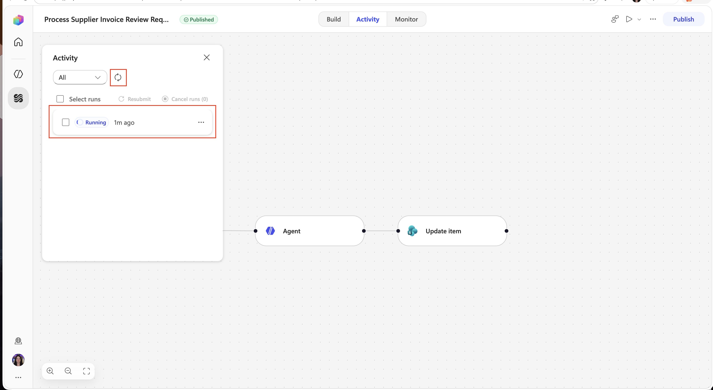
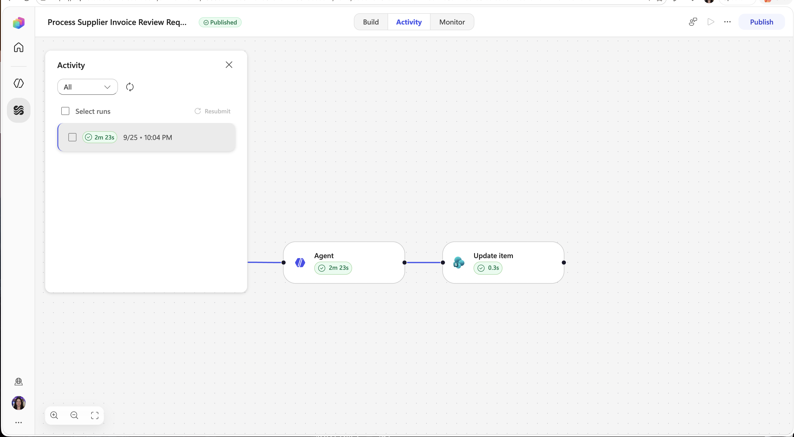
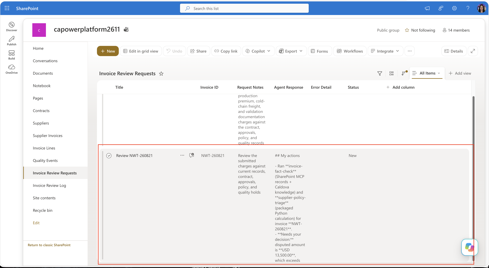
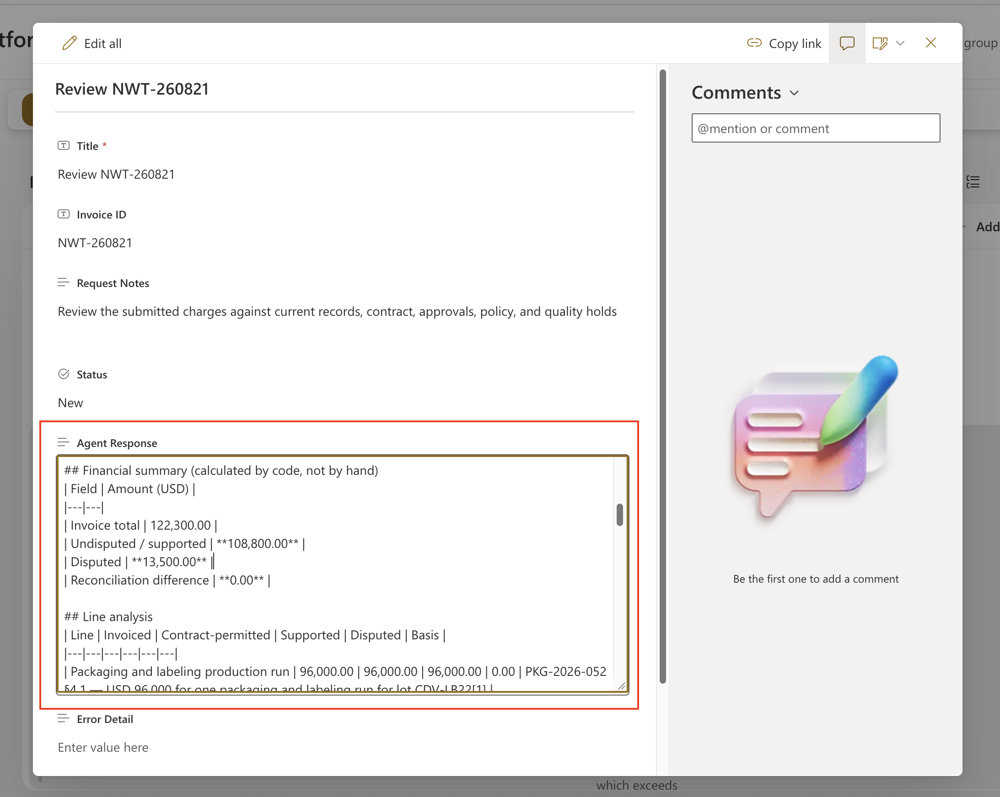

<!-- markdownlint-disable MD034 -->

# 7 - Run the Solution End to End

Your agent and workflow are ready. Test the end-to-end process with a second invoice, **NWT-260821**, whose invoice and line records are already prepared in SharePoint. This test passes an invoice ID, not an attached workbook.

1. Open the invoice review request list:

   +++https://@lab.CloudCredential(AITour27M365E7).TenantPrefix.sharepoint.com/sites/CaldovaSupplierOps/Lists/Invoice%20Review%20Requests/AllItems.aspx+++

1. Select the **New** button.

    

1. Enter the following information in the form then select the **Save** icon:

    | Field | Value |
    | --- | --- |
    | Title | `Review NWT-260821` |
    | Invoice ID | `NWT-260821` |
    | Request Notes | `Review the submitted charges against current records, contract, approvals, policy, and quality holds.` |
    | Status | `New` |

    

1. Return to the tab with the Workflow open and select the **Activity** tab.

    

1. Select the **Refresh** icon until you see a running or completed run for the newly created request. A quick run may already be completed when you first refresh.

    

    > [!TIP]
    > If no run appears after refreshing, verify that the workflow is published, the trigger targets **Invoice Review Requests** on the correct site, and the SharePoint connection is signed in. The trigger runs when an item is created, not when an existing item is edited. If a node fails, open its activity details, address the reported error, then retry with a new test request. Do not create repeated requests while a run is still processing.

1. Open the run and confirm the trigger, Agent, and Update item nodes complete successfully.

    

1. Return to the SharePoint **Invoice Review Requests** list and refresh it. Open the **Review NWT-260821** item you created. Verify that **Status** is **Complete**, **Agent Response** is populated, and **Error Detail** is blank. Check these values alongside the successful workflow run, not in isolation.

    

1. Open the request item and review the Agent Response for the expected result:

   - Invoice total **$122,300**.
   - Supported amount **$108,800**.
   - Disputed amount **$13,500**.
   - Reconciliation difference **$0**.
   - Human review required because the disputed amount exceeds **$10,000**, plus any other reasons supported by the retrieved evidence.
   - Contract and policy claims backed by retrieved content and available citations.
   - Any missing or conflicting evidence and retrieval limitations explicitly reported.
   - A statement that no financial or supplier action was taken and that no submitted file was compared.

    

    If the amounts match but the evidence or grounding checks fail, the test has not passed. **Complete** indicates workflow processing, not financial approval. This workflow stores the response on the request; it does not attach a PDF or create an Invoice Review Log entry.

## What happened

| Layer | Responsibility |
| --- | --- |
| Request list and Workflow | Started the review and stored the readable response |
| SharePoint connector tools or MCP | Retrieved current records; the workflow's Update item action stored the response on the request |
| SharePoint knowledge | Supplied contract, approval, policy, and quality-document facts |
| Skills and sandbox | Organized facts, calculated the result, and generated a review brief; the workflow did not persist the PDF |
| Human reviewer | Owns every financial decision |

No payment, rejection, supplier change, or quality-hold change was made.

Congratulations. Select **Next**, then **Submit** to finish the lab.
