<!-- markdownlint-disable MD034 -->

# 1 - Build the Supplier Assurance Agent

> [!IMPORTANT]
> This is a draft Work IQ alternative to the main agent-setup section, not a complete alternative lab. The remaining main-lab sections assume separate SharePoint knowledge and connector or MCP tools. Do not combine the paths without adapting those sections.

The first step in creating your agent is to establish its purpose and boundaries.

1. Open Microsoft Edge Browser (the Internet icon on the VM desktop) in your virtual machine and go to +++https://copilotstudio.microsoft.com+++.
1. Sign in with the username and TAP from the **Resources** tab.
1. Select the environment dropdown in the bottom left-hand corner and choose the **DevOne** environment.

    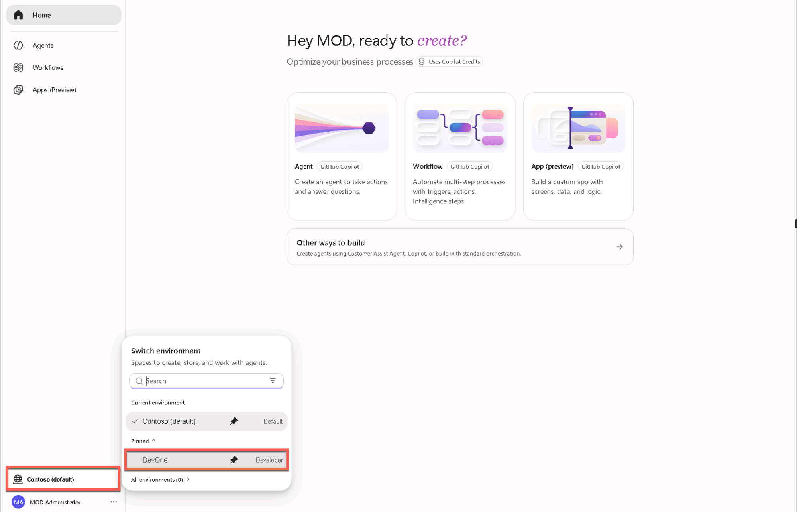

1. On the home page, select the **Agent** tile.

    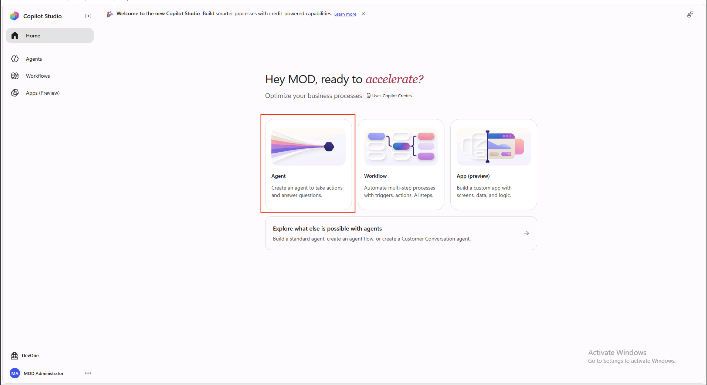

1. Select the **Untitled Agent** text to rename the agent. Name the agent:

    ```text
    Supplier Assurance Agent
    ```

    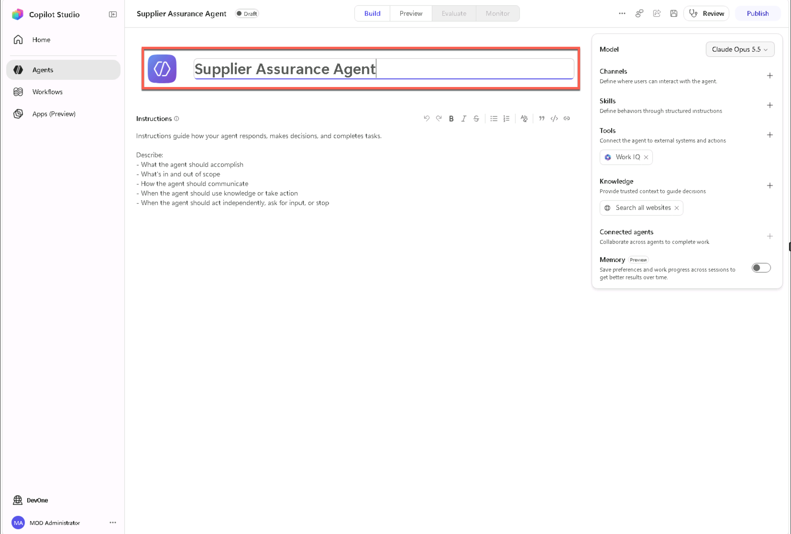

1. Paste the following in the **Instructions** text box:

    ```text
    You are the Caldova Supplier Assurance Agent.

    You help sourcing professionals determine which supplier invoice charges are supported, which should be challenged, and whether human review is required.

    Your source of truth for all supplier, invoice and contract information is the CaldovaSupplierOps SharePoint site.

    Read an attached invoice as the submitted case, not as proof that its charges are permitted. Use Work IQ for current supplier, invoice, line, quality records, contracts, policy, and written approvals. Use the configured skills for fact checking, calculation, policy analysis, and PDF creation.

    Make contract, policy, and approval claims only when supported by retrieved governing document content. Preserve available document identities, locations, and citation references in evidenceCitations, and use them in the response and review brief. Never invent facts, document locations, or citations. If retrieval fails or citations are unavailable, explicitly report the limitation and any missing or conflicting evidence; do not present unsupported terms as verified. Correct numbers alone do not prove grounding.

    Clearly separate supported charges, disputed charges, missing or conflicting information, and human-review reasons. Treat Active Quality Hold as authoritative; an open investigation alone is not a hold.

    For an interactive Invoice Review Log entry, set Review Source to Interactive Agent only after verifying that it is a supported choice. After writing, read the saved item back and verify the source, supported amount, disputed amount, and human-review flag. Report a blank, missing, mismatched, or unreadable value as an incomplete write, not success. Do not claim a PDF is attached when only its name was recorded.

    Ask for confirmation before creating an Invoice Review Log item. Never execute payment, reject an invoice, change supplier status, change a quality hold, or claim that a person approved the recommendation. Use memory only for communication preferences, never case facts.
    ```

    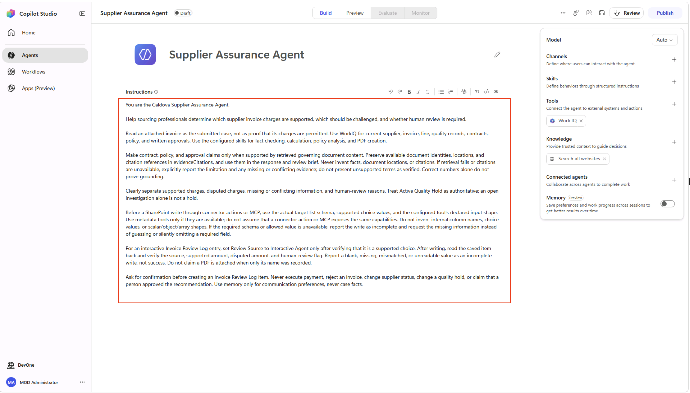

1. On the right-hand side, select the **X** next to **Search all websites** under **Knowledge**. Remove this default web knowledge so the lab uses only the knowledge sources we configure.

    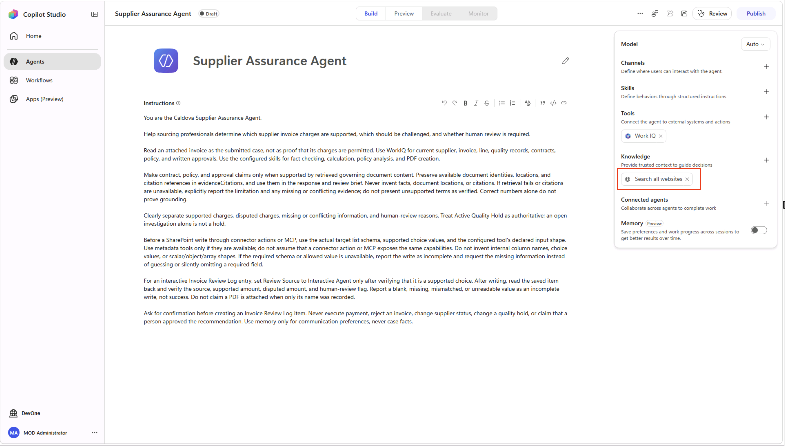

1. Select the **Work IQ** pill under **Tools** to open the edit tool screen.

    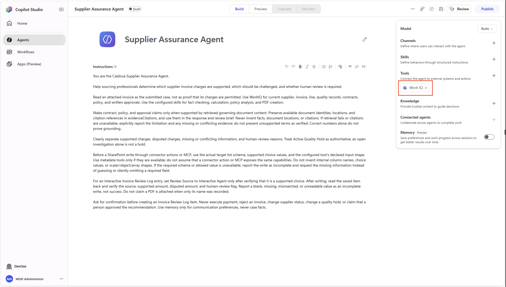

    > [!NOTE]
    > **Why:** Contracts, policy, approvals, and quality documents govern supplier reviews. These files are stored in SharePoint, which is accessible as a source in the Work IQ tool.

1. The Work IQ tool exposes a variety of sources, but we don't need all of these. Select the **check mark** next to the **OneDrive**, **Teams**, **Outlook** and **Calendar** sources to **uncheck** them and make sure they aren't available.

    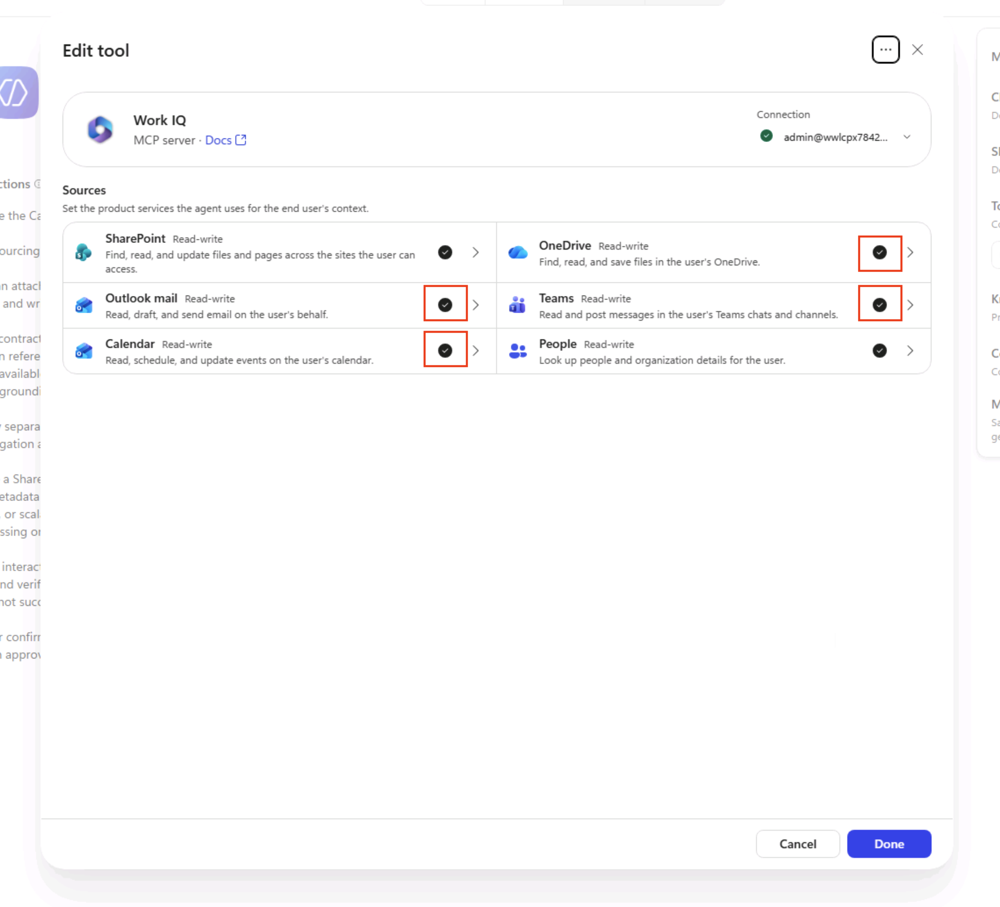

    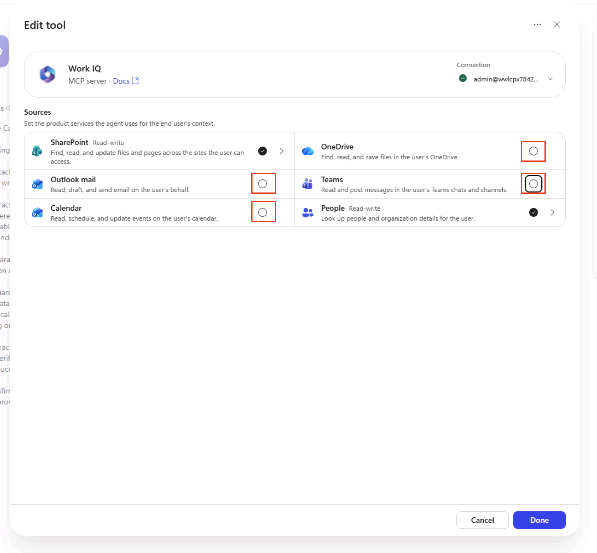

1. Select the **arrow** next to the **People** source.

    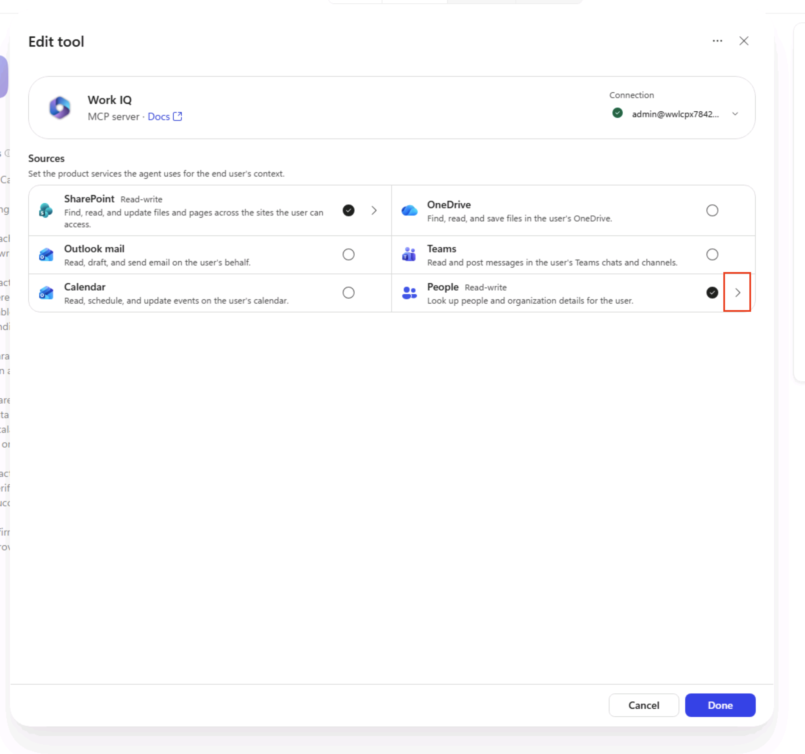

1. Select the **Access level** dropdown and choose **Read-only** so that we only give the agent access to what it needs to do (retrieve people information).

    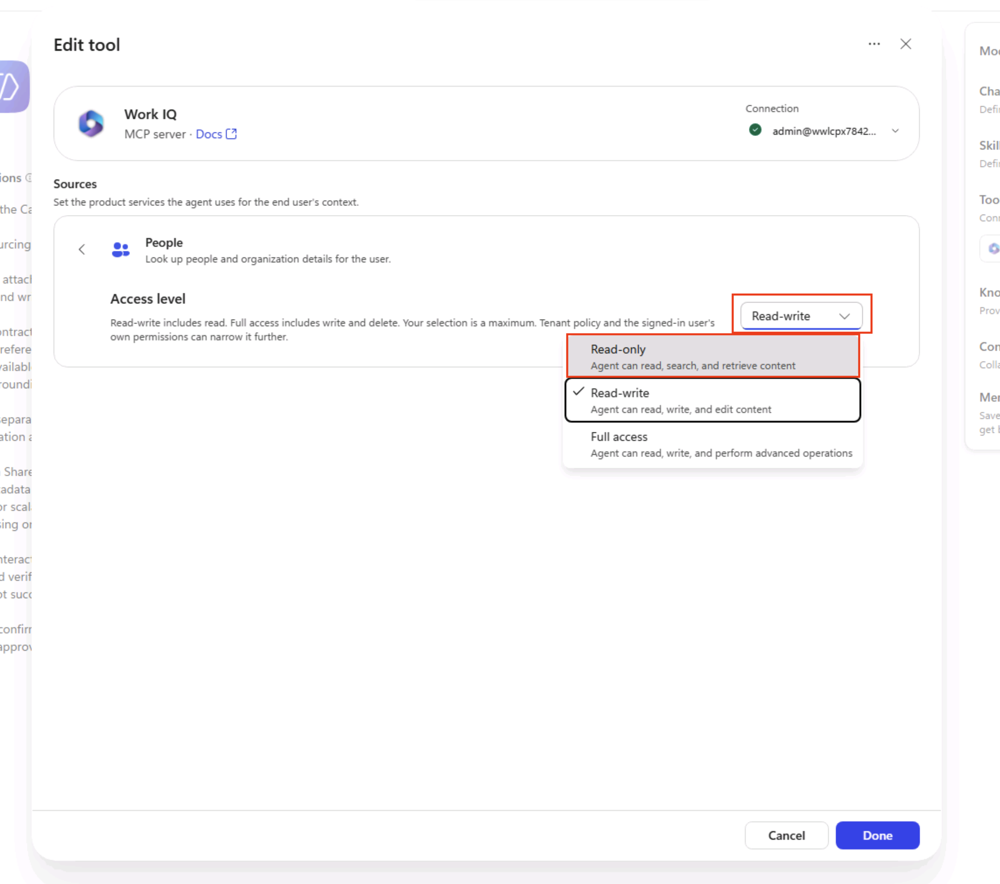

1. Select the **Done** button to save your changes. Leave the SharePoint source with read-write access.

    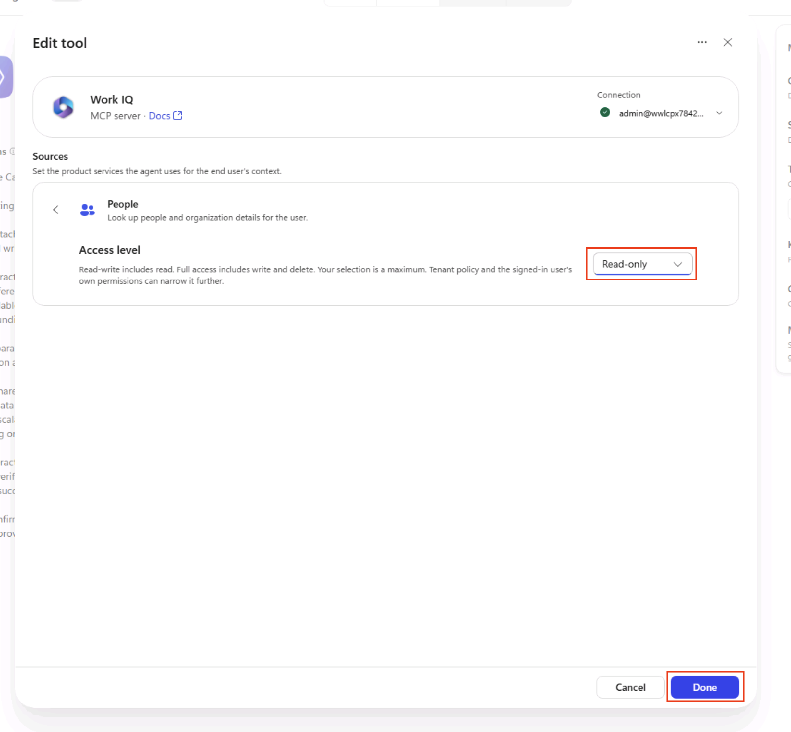

    > [!NOTE]
    > **Why:** The Work IQ tool can perform read and write operations on several sources (SharePoint, Outlook, Calendar, etc.). Use **least privilege** access: provide the agent with only the minimum access it needs.

1. Select the **Save icon** to save your agent configuration.

    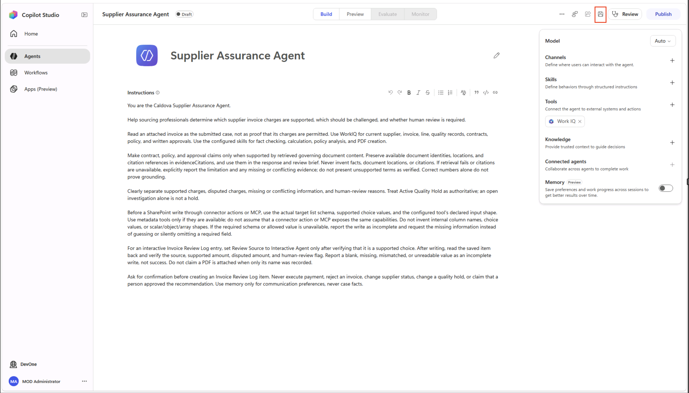

This draft ends after agent setup; the remaining Work IQ-specific steps are not yet provided. To follow the complete main lab, return to [Build the Supplier Assurance Agent](../01-Build-The-Agent.md), apply that configuration (which removes Work IQ), then continue to [Add SharePoint Knowledge](../02-Add-SharePoint-Knowledge.md).
